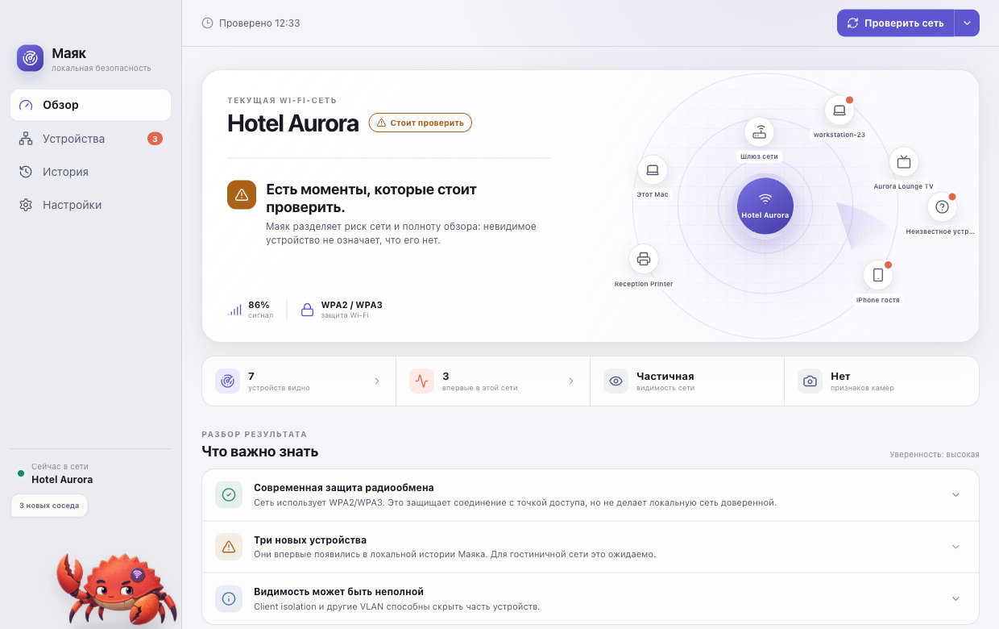
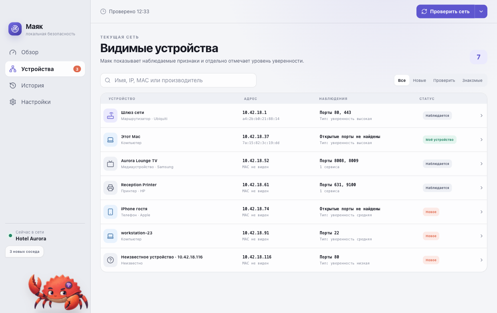

# Маяк

[](https://github.com/alxshmrv/mayak/actions/workflows/ci.yml)
[](https://github.com/alxshmrv/mayak)
[](https://github.com/alxshmrv/mayak)
[](https://www.rust-lang.org/)
[](LICENSE)

Локальный центр доверия к Wi‑Fi для macOS и Windows. Маяк объясняет состояние
текущей сети, показывает наблюдаемые устройства и помогает заметить новых
соседей — без аккаунта, облака и отправки сетевых данных наружу.

Системная часть написана на Rust и Tauri 2, интерфейс — на React.



> Используйте Маяк только в сетях, которыми вы владеете, управляете или имеете
> явное разрешение проверять. Приложение предназначено для защитной
> диагностики: оно не подбирает пароли, не эксплуатирует устройства и не
> обходит контроль доступа.

## Возможности

- SSID, BSSID, защита, канал, диапазон, RSSI, шум и скорость соединения;
- IP-адреса, подсеть, шлюз, DNS, прокси и признаки активного VPN;
- обнаружение через ARP, mDNS, SSDP/UPnP, ONVIF и ограниченные TCP-проверки
  только в текущей локальной подсети;
- объединение IP, MAC, производителя, локальных имён, сервисов, портов и
  наблюдений в одну карточку устройства;
- понятные статусы «моё», «знакомое», «игнорировать» и уведомления о новых
  устройствах;
- отдельные оценки риска сети, полноты наблюдения и уверенности вывода;
- локальная история для каждой сети и фоновый мониторинг;
- явное различие между подтверждённой и возможной камерой;
- анимированный маскот — краб Ferris, который реагирует на состояние проверки.



Имена устройств появляются только тогда, когда сеть или само устройство
объявляет их через локальный DNS, Bonjour/mDNS, SSDP или SMB. Если надёжного
имени нет, Маяк показывает наблюдаемые адреса и уровень уверенности, не
выдумывая производителя или тип устройства.

## Честные ограничения

Маяк показывает только то, что этот компьютер действительно может наблюдать.
Client isolation в отеле, отдельные VLAN, фильтрация multicast, спящие
устройства, межсетевой экран и рандомизация MAC могут скрыть соседей или
изменить их идентичность. Отсутствие найденной камеры не доказывает отсутствие
камеры в помещении или сети.

Радар в интерфейсе — визуализация процесса обнаружения. Радиус означает
уверенность в классификации устройства, а не физическое расстояние до него.

## Установка и статус релиза

Проект публикуется как open-source beta для Apple Silicon/macOS 15+ и
64-битных Windows 10/11. На странице
[Releases](https://github.com/alxshmrv/mayak/releases) выбирайте готовый
установщик, а не автоматически добавленные GitHub архивы исходников:

- `Mayak-<версия>-macos-arm64.dmg` — установщик для Mac;
- `Mayak-<версия>-windows-x64-setup.exe` — рекомендуемый установщик Windows;
- `Mayak-<версия>-windows-x64.msi` — MSI для ручного или корпоративного
  развёртывания.

Публичные beta-сборки пока не подписаны сертификатами Apple и Microsoft:
macOS Gatekeeper или Windows SmartScreen могут показать предупреждение.
Проверяйте SHA-256 рядом с установщиком и загружайте файлы только из Releases
этого репозитория.

Для самостоятельной сборки нужны Rust 1.88+, Node.js 22.12+ и системные
инструменты разработки целевой платформы:

```bash
git clone https://github.com/alxshmrv/mayak.git
cd mayak
npm ci
npm run tauri build
```

DMG, NSIS setup.exe или MSI появятся в `src-tauri/target/release/bundle/`.

## Разработка

```bash
npm ci
npm run check
cargo fmt --manifest-path src-tauri/Cargo.toml --all -- --check
cargo clippy --manifest-path src-tauri/Cargo.toml --all-targets -- -D warnings
cargo test --manifest-path src-tauri/Cargo.toml --all-targets
npm run tauri dev
```

GitHub Actions выполняет основные проверки отдельно на macOS и Windows, а при
публикации тега собирает DMG, NSIS setup.exe и MSI. Правила работы с проектом
описаны в [CONTRIBUTING.md](CONTRIBUTING.md).

## Приватность и системные разрешения

Все результаты хранятся локально в SQLite внутри стандартного каталога данных
приложения (`Application Support` на macOS или `%APPDATA%` на Windows). Маяк
не содержит телеметрии, аналитики, рекламных SDK или облачного API. Подробности
— в [PRIVACY.md](PRIVACY.md).

- **Геопозиция** необязательна и нужна системным Wi‑Fi API macOS и современных
  версий Windows только для раскрытия SSID/BSSID. Географические координаты
  приложение не получает и не сохраняет.
- **Локальная сеть** нужна для обнаружения соседних устройств.
- **Уведомления** запрашиваются только после включения соответствующих
  переключателей в настройках.

## Архитектура

```text
React UI
  └─ типизированные Tauri-команды и события
      ├─ платформенный слой
      │   ├─ macOS: CoreWLAN/CoreLocation + системные утилиты
      │   └─ Windows: Native Wi-Fi + IP Helper + Winsock
      ├─ движок обнаружения (таблица соседей/ARP, mDNS, SSDP, ONVIF, bounded TCP)
      ├─ fingerprinting + объяснимая оценка риска
      └─ SQLite: история, доверие к устройствам и настройки
```

Сканер ограничивает число одновременных соединений, привязывает multicast и
ONVIF-сокеты к Wi‑Fi-интерфейсу и не выходит за границы текущей локальной
подсети.

## Безопасность и участие

Уязвимость не следует публиковать в обычном issue — используйте приватный
канал из [SECURITY.md](SECURITY.md). Идеи и исправления приветствуются:
[CONTRIBUTING.md](CONTRIBUTING.md), [кодекс поведения](CODE_OF_CONDUCT.md).

## Лицензия

Исходный код и оригинальные визуальные материалы проекта распространяются по
лицензии [MIT](LICENSE). Сторонние компоненты сохраняют собственные лицензии;
см. [THIRD_PARTY_NOTICES.md](THIRD_PARTY_NOTICES.md) и lock-файлы.
