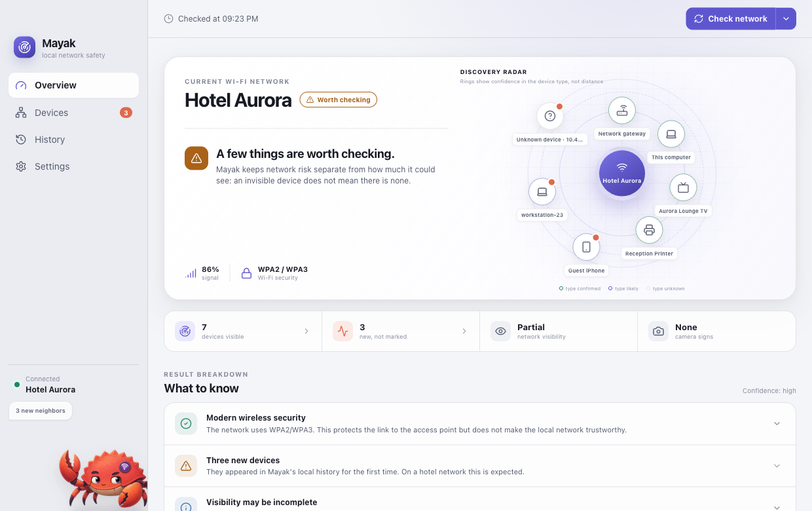
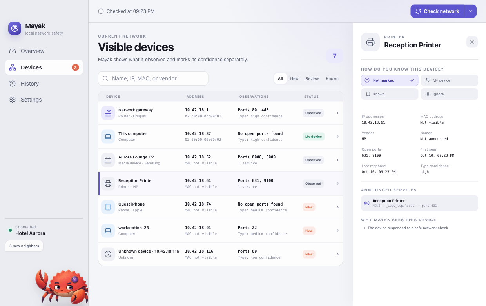

# Mayak

**English** · [Русский](README.ru.md)

[](https://github.com/alxshmrv/mayak/actions/workflows/ci.yml)
[](https://github.com/alxshmrv/mayak/releases)
[](https://github.com/alxshmrv/mayak)
[](https://github.com/alxshmrv/mayak)
[](https://www.rust-lang.org/)
[](LICENSE)

**A local-first Wi‑Fi trust center for macOS and Windows.** Mayak explains the
state of the network you are connected to, shows the devices it can observe
around you, and helps you notice new neighbors — with no account, no cloud,
and no network data leaving your computer.

The system layer is written in Rust on top of Tauri 2; the interface is React.
The app is available in English and Russian. *Mayak* (Russian: «Маяк») means
*lighthouse*.



> Only use Mayak on networks you own, administer, or have explicit permission
> to inspect. It is a defensive diagnostic tool: it does not crack passwords,
> exploit devices, or bypass access controls.

## Why Mayak

Joining a hotel, airport, office, or a friend's Wi‑Fi usually leaves the same
questions unanswered: is this network configured sensibly, what else is on it,
and did something new just show up? Network scanners answer with raw tables
built for administrators. Mayak answers in plain language first — a verdict
you can read in seconds — and keeps the evidence and full technical details
one click away.

It is built around a few principles:

- **Conclusion first, evidence second.** Every finding links back to what was
  actually observed.
- **Never promise the invisible.** Client isolation, filtering, and missing OS
  permissions are shown as limits on the result, not hidden.
- **Three separate scores.** Network risk, observation coverage, and
  confidence are reported independently instead of being collapsed into one
  opaque number.
- **Your data stays local.** Active probing is restricted to the current
  Wi‑Fi subnet, and nothing is uploaded anywhere.

## Features

- SSID, BSSID, security mode, channel, band, RSSI, link rate, and any other
  parameters the operating system exposes;
- IP addresses, subnet, gateway, DNS, proxy, and signs of an active VPN;
- device discovery via ARP, dynamic DNS-SD/mDNS enumeration, SSDP/UPnP, ONVIF,
  and bounded TCP checks — strictly within the current local subnet;
- one card per device that merges IP, MAC, vendor, local names, services,
  ports, and observations;
- offline vendor lookup from a bundled snapshot of the public IEEE MA-L, MA-M,
  and MA-S registries — MAC addresses never leave the computer;
- simple trust labels — *mine*, *known*, *ignore* — plus notifications about
  new devices;
- separate scores for network risk, observation coverage, and confidence;
- per-network local history and background monitoring;
- automatic checks for signed updates, with confirmation before installing
  and restarting;
- an explicit distinction between a *confirmed* and a *possible* camera;
- English and Russian interface that follows the system language or can be
  switched in settings;
- an animated mascot — Ferris the crab — that reacts to the scan state.



Device names appear only when the network or the device itself announces them
via local DNS, Bonjour/mDNS, SSDP, or SMB. Mayak first enumerates the available
DNS-SD service types and then resolves the services it finds along with their
TXT metadata, so it is not limited to a short list of known protocols. When no
reliable name is available, it shows the vendor, the observed addresses, and
its confidence level instead of making up a specific model or device type.

## Honest limitations

Mayak shows only what this computer can actually observe. Hotel client
isolation, separate VLANs, multicast filtering, sleeping devices, firewalls,
and MAC randomization can hide neighbors or change their identity. Not finding
a camera does not prove there is no camera in the room or on the network.

The radar in the interface visualizes the discovery process. Its radius
represents classification confidence, not the physical distance to a device.

## Supported platforms

| Platform | Architecture | Minimum version | Packages | System integration |
| --- | --- | --- | --- | --- |
| macOS | Apple Silicon (arm64) | macOS 15 | DMG | CoreWLAN, CoreLocation, system routes and ARP |
| Windows | x64 | Windows 10 / 11 | NSIS `setup.exe`, MSI | Native Wi‑Fi, IP Helper, Winsock |

Device discovery, history, trust labels, risk scoring, monitoring, and the
interface are the same on both platforms. The set of low-level Wi‑Fi metrics
can differ: for example, Windows does not always expose noise, country code,
or channel width. In that case Mayak shows "unknown" rather than guessing. See
the [platform support matrix](docs/PLATFORMS.md) for details.

## Installation

Mayak is published as an open-source beta for Apple Silicon Macs running
macOS 15+ and 64-bit Windows 10/11. The current release is
[v0.2.0](https://github.com/alxshmrv/mayak/releases/tag/v0.2.0):

- [Mayak-0.2.0-macos-arm64.dmg](https://github.com/alxshmrv/mayak/releases/download/v0.2.0/Mayak-0.2.0-macos-arm64.dmg)
  — Apple Silicon Mac;
- [Mayak-0.2.0-windows-x64-setup.exe](https://github.com/alxshmrv/mayak/releases/download/v0.2.0/Mayak-0.2.0-windows-x64-setup.exe)
  — recommended Windows installer;
- [Mayak-0.2.0-windows-x64.msi](https://github.com/alxshmrv/mayak/releases/download/v0.2.0/Mayak-0.2.0-windows-x64.msi)
  — MSI for manual or managed deployment.

Public beta builds are not yet signed with Apple or Microsoft certificates, so
macOS Gatekeeper or Windows SmartScreen may show a warning. Verify the SHA-256
checksum published next to each installer, and download files only from this
repository's Releases. Step-by-step installation, checksum verification, and
removal are covered in the [installation guide](docs/INSTALLATION.md).

GitHub automatically attaches `Source code` archives to every release. You do
not need them for a regular install — pick the DMG, `setup.exe`, or MSI.

Starting with version 0.3.0, Mayak checks for a new public release at launch
and then at most once every six hours. Updates are downloaded and installed
only after you confirm. Every package is verified against the project's
embedded public key; an unsigned or modified file is never installed.

## Building from source

You need Rust 1.88+, Node.js 22.12+, and the native development tools for your
target platform:

```bash
git clone https://github.com/alxshmrv/mayak.git
cd mayak
npm ci
npm run tauri build
```

macOS produces a DMG; Windows produces an NSIS `setup.exe` and an MSI. The
output lands in `src-tauri/target/release/bundle/`.

## Development

```bash
npm ci
npm run check
cargo fmt --manifest-path src-tauri/Cargo.toml --all -- --check
cargo clippy --manifest-path src-tauri/Cargo.toml --all-targets -- -D warnings
cargo test --manifest-path src-tauri/Cargo.toml --all-targets
npm run tauri dev
```

GitHub Actions runs the main checks separately on macOS and Windows. When a
release tag is pushed, it builds the DMG, NSIS `setup.exe`, and MSI, signs the
updater packages, and validates the manifest before publishing. Project
guidelines are in [CONTRIBUTING.md](CONTRIBUTING.md).

## Privacy and system permissions

All results are stored locally in SQLite inside the app's standard data
directory (`Application Support` on macOS, `%APPDATA%` on Windows). Mayak
contains no telemetry, analytics, ad SDKs, or cloud API. For updates it only
contacts the public GitHub Releases and never adds network or device details
to the request. Details are in [PRIVACY.md](PRIVACY.md).

- **Location** is optional. macOS and recent Windows versions gate SSID/BSSID
  access behind this permission; Mayak never receives or stores geographic
  coordinates.
- **Local network** access is required to discover nearby devices.
- **Notifications** are requested only after you enable the corresponding
  toggles in settings.

## Architecture

```text
React UI
  └─ typed Tauri commands and events
      ├─ platform layer
      │   ├─ macOS: CoreWLAN / CoreLocation + system utilities
      │   └─ Windows: Native Wi-Fi + IP Helper + Winsock
      ├─ discovery engine (ARP, DNS-SD/mDNS, SSDP, ONVIF, bounded TCP)
      ├─ local IEEE OUI + fingerprinting + explainable risk scoring
      ├─ SQLite: history, device trust, and settings
      └─ Tauri Updater: HTTPS manifest + mandatory minisign signature
```

The scanner caps the number of concurrent connections, binds multicast and
ONVIF sockets to the Wi‑Fi interface, and never leaves the boundaries of the
current local subnet.

## Documentation

The supporting documents below are currently written in Russian.

- [Installation and removal](docs/INSTALLATION.md)
- [Platform support and differences](docs/PLATFORMS.md)
- [Releasing and the update key](docs/RELEASING.md)
- [Product principles](PRODUCT.md)
- [Design system](DESIGN.md)
- [Privacy](PRIVACY.md)
- [Security policy](SECURITY.md)
- [Contributing](CONTRIBUTING.md)
- [Changelog](CHANGELOG.md)

## Security and contributing

Please do not report vulnerabilities in public issues — use the private
channel described in [SECURITY.md](SECURITY.md). Ideas and fixes are welcome:
see [CONTRIBUTING.md](CONTRIBUTING.md) and the
[Code of Conduct](CODE_OF_CONDUCT.md). When filing issues, replace real SSIDs,
BSSIDs, IP and MAC addresses, and device names with placeholders.

## License

The source code and original visual assets are released under the
[MIT License](LICENSE). Third-party components keep their own licenses; see
[THIRD_PARTY_NOTICES.md](THIRD_PARTY_NOTICES.md) and the lock files.
